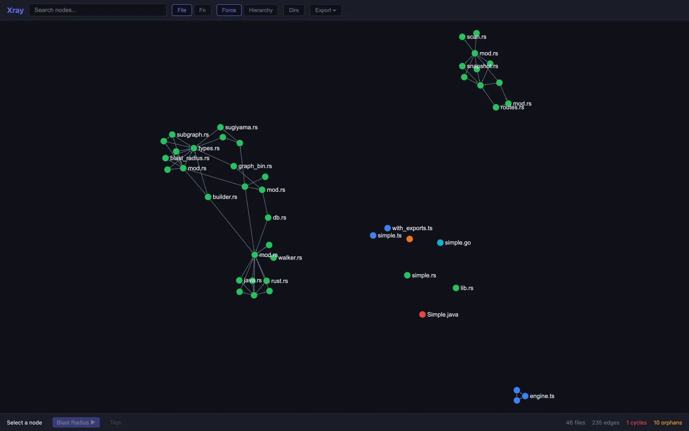

# Xray

Xray is a fast, local-first codebase architecture visualizer. It scans a repository with tree-sitter, builds dependency graphs, and serves an interactive browser UI from a Rust CLI.



## Highlights

- **Offline by default** — source code is scanned locally and is not sent to external services.
- **Multi-language scanning** — TypeScript/JavaScript, Python, Rust, Go, and Java support are included.
- **Interactive graph UI** — explore file-level and function-level relationships in the browser.
- **Architecture analysis** — inspect cycles, orphan files, directory groups, annotations, and blast radius.
- **AI context export** — export graph slices as structured JSON or Markdown for LLM/agent context.

> Status: early-stage project. APIs, CLI flags, and output formats may change before v1.0.

## Installation

### From source

```bash
git clone https://github.com/antoinehoriot/xray-viz.git
cd xray-viz
cargo install --path crates/xray-cli
```

### Development build

```bash
cargo build --all
```

To build the full web UI bundle:

```bash
cd web
bun install
bun run build
```

If the web bundle has not been built, `xray view` serves a minimal fallback UI.

## Usage

Open an interactive graph for the current repository:

```bash
xray view .
```

Scan and print graph JSON:

```bash
xray scan . --pretty
```

Show cycle and orphan reports:

```bash
xray scan . --cycles --orphans
```

Write graph output to a file:

```bash
xray scan . --output graph.json
```

Watch for changes while serving the UI:

```bash
xray view . --watch
```

Export AI/LLM context from a starting node:

```bash
xray export . --from src/main.rs --depth 2 --format markdown
```

## Repository layout

```text
crates/xray-core/   Core scanner, cache, graph, and layout logic
crates/xray-cli/    Command-line interface and embedded HTTP server
crates/xray-wasm/   WebAssembly bindings for browser graph operations
web/                TypeScript/Sigma.js browser UI
grammars/           Tree-sitter queries
tests/fixtures/     Language parser fixtures
docs/               Spec, brief, roadmap and planning docs
```

## How this was built

Xray is also an experiment in agentic development. It was specified, planned and
built with Claude Code driving a small team of agents, and the coordination state
is committed on purpose so the process can be inspected, not just the result.

| Path | Tool | What it holds |
|---|---|---|
| [`docs/BRIEF.md`](docs/BRIEF.md), [`docs/SPEC.md`](docs/SPEC.md) | | The problem statement and the technical spec the agents built from |
| [`.seeds/`](.seeds/) | [seeds](https://github.com/jayminwest/seeds) | The issue tracker: 28 tasks and bugs, from architecture research to fixes, all closed |
| [`.mulch/`](.mulch/) | [mulch](https://github.com/jayminwest/mulch) | 77 expertise records (conventions, decisions, failures) that agents load at the start of a session and append to before finishing |
| [`.overstory/`](.overstory/) | [overstory](https://github.com/jayminwest/overstory) | Multi-agent orchestration: scout, builder, reviewer, lead, merger, coordinator and monitor roles working in separate git worktrees |
| [`.canopy/`](.canopy/) | [canopy](https://github.com/jayminwest/canopy) | Prompt registry (set up, currently empty) |
| [`CLAUDE.md`](CLAUDE.md), [`AGENTS.md`](AGENTS.md) | | Instructions every agent session starts from |

The human part: choosing the problem, reviewing the spec, setting the quality gates
(`fmt`, `clippy -D warnings`, tests, CI) and deciding what ships.

## Development

Run Rust quality checks:

```bash
cargo fmt --all -- --check
cargo clippy --all-targets --all-features -- -D warnings
cargo test --all
```

Run web checks:

```bash
cd web
bun install
bun run typecheck
bun run build
```

## Privacy and generated files

Xray writes scan caches and annotations under `.xray/` in the repository being scanned. These files are local working data and should not be committed unless you intentionally want to share annotations.

Before opening a pull request, verify that no local secrets, caches, build artifacts, or machine-specific config are staged:

```bash
git status --short
git diff --cached --name-only
```

## Contributing

Contributions are welcome. Please read [CONTRIBUTING.md](CONTRIBUTING.md) before opening an issue or pull request.

## Security

Please report security issues privately using the process in [SECURITY.md](SECURITY.md).

## License

This project is licensed under the [MIT License](LICENSE).
